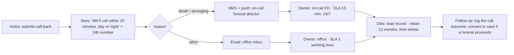
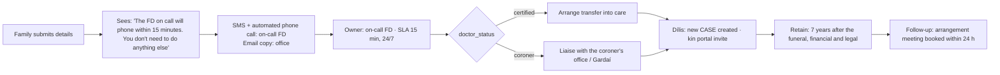
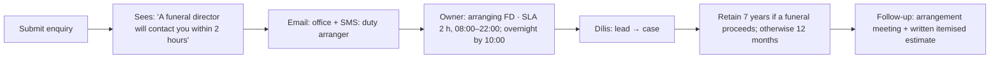
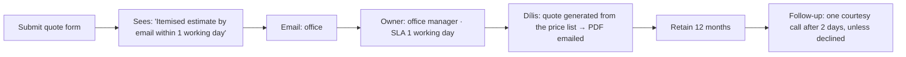
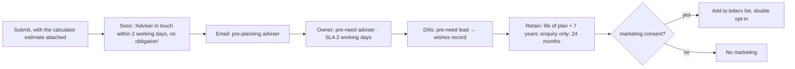
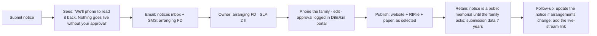
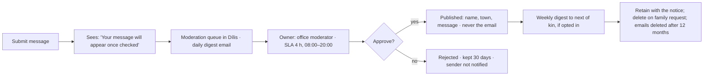
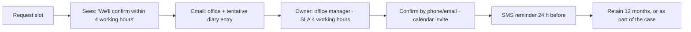
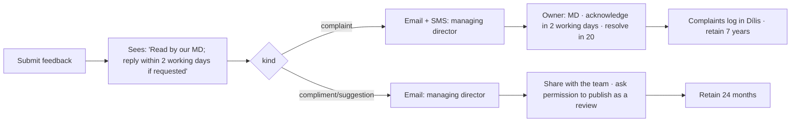
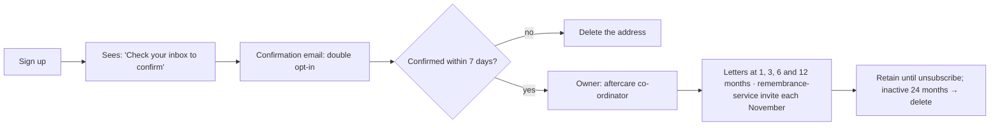

# 04 · Form workflows

Each flow: **trigger → what the visitor sees → who is notified → internal owner → response SLA → storage and retention → follow-up**.
The same owner, SLA and retention values are in `site/forms.mjs`, which the local server logs for every submission. In production the server forwards each record to **Dílis** (webhook → case or lead), which sends the email and SMS alerts and escalates any breach of an SLA.

**Data storage (all forms):** submissions are encrypted in transit (HTTPS) and at rest. They are stored in the Dílis platform, hosted in the EU, and are never emailed in full (alerts contain a link, not the personal data). Access is role-based. The local demo writes to `site/data/*.jsonl` (gitignored).

**Standard escalation:** if the SLA passes with no "contacted" status, SMS the backup director, then the managing director.

---

### 1. Urgent call-back

### 2. First notification of a death

### 3a. Arrangement enquiry

### 3b. Quote request

### 4. Pre-planning enquiry

### 5. Death-notice submission

### 6. Condolence (moderated)

### 7. Appointment booking

### 8. Feedback / complaint

### 9. Grief-support sign-up

## SLA summary

| Form | Owner | SLA | Channel |
|---|---|---|---|
| Call-back (death or arranging) | On-call FD | **15 min, 24/7** | SMS + push |
| First notification | On-call FD | **15 min, 24/7** | SMS + automated call |
| Arrangement enquiry | Arranging FD | 2 h (08:00–22:00) | Email + SMS |
| Death notice | Arranging FD | 2 h | Email + SMS |
| Condolence moderation | Office | 4 h (08:00–20:00) | Queue |
| Appointment | Office manager | 4 working hours | Email |
| Quote | Office manager | 1 working day | Email |
| Pre-planning | Pre-need adviser | 2 working days | Email |
| Feedback / complaint | Managing director | 2 working days (acknowledge) | Email (+ SMS for complaints) |
| Newsletter | Aftercare | Automated | Email |
