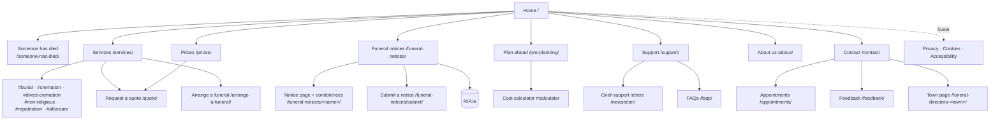

# 05 · Sitemap and wireframes

## Sitemap



All 21 built pages are listed in the generated `dist/sitemap.xml`.

## Global elements (every page)

```
┌──────────────────────────────────────────────────────────┐
│ ▓ 24-hour line: 087 000 0000      (dark bar, tappable)   │  ← desktop adds "Someone has died? We answer…"
├──────────────────────────────────────────────────────────┤
│ Hawthorn Funerals                           [☰ Menu]     │  ← sticky header
│ FAMILY FUNERAL DIRECTORS · NAAS                          │    desktop: 8 links, "Someone has died" first, in red
└──────────────────────────────────────────────────────────┘
          … page …
┌──────────────────────────────────────────────────────────┐
│ Footer: address · phones · link columns · IAFD           │
│ Privacy · Cookies · Accessibility · Cookie settings      │
└──────────────────────────────────────────────────────────┘
┌──────────────────────────┬───────────────────────────────┐
│ [📞 Call 24/7]            │ [Request a call]              │  ← sticky mobile call bar (< 992 px)
└──────────────────────────┴───────────────────────────────┘
```

## Home (mobile)

```
┌──────────────────────────────┐
│ HERO (calm landscape, faded) │
│ FAMILY FUNERAL DIRECTORS…    │
│ We're here to help,          │
│ day or night                 │
│ If someone close to you has… │
│ [ Call 087… (24 hours) ]     │
│ [ What to do when someone… ] │
├──────────────────────────────┤
│ ▢ Someone has just died  →   │  3 route cards
│ ▢ Arranging a funeral    →   │
│ ▢ Planning ahead         →   │
├──────────────────────────────┤
│ Recent funeral notices       │
│ ▢ Mary Kelly (née Byrne)     │
│ All notices → · RIP.ie link  │
│ ▓ We answer every call…  ▓   │  dark panel + number
├──────────────────────────────┤
│ [premises image]             │
│ 3 generations… ✓ IAFD        │
│ ✓ written estimate ✓ chapel  │
├──────────────────────────────┤
│ Clear prices                 │
│ ▢ Direct cremation from €…   │
│ ▢ Cremation funeral from €…  │
│ ▢ Traditional burial from €… │
├──────────────────────────────┤
│ What families say (3 quotes) │
│ (IAFD) (since 1952) (Google) │
└──────────────────────────────┘
```

## Services

```
┌──────────────────────────────────────────────┐
│ HERO: "A funeral that feels like them"       │
├──────────────────────┬───────────────────────┤
│ Traditional + burial │ Cremation funeral     │  6 cards, 2 columns on desktop
│ ✓✓✓  Prices →        │ ✓✓✓  Prices →         │  each has an anchor (#burial …)
├──────────────────────┼───────────────────────┤
│ Direct cremation     │ Humanist/non-relig.   │
├──────────────────────┼───────────────────────┤
│ Repatriation         │ After the funeral     │
├──────────────────────┴───────────────────────┤
│ [lilies]  Not sure what to choose?           │
│           [Request a quote] [Book a time]    │
└──────────────────────────────────────────────┘
```

## Funeral notices (list + single notice)

```
LIST                                       SINGLE NOTICE
┌──────────────────────────┬──────────┐    ┌───────────────────────────────┐
│ HERO (candle)            │          │    │ FUNERAL NOTICE                │
├──────────────────────────┼──────────┤    │ Mary Kelly (née Byrne)        │
│ [Search name or town   ] │ RIP.ie   │    │ Naas, Co. Kildare             │
│ ▢ Name                   │ panel    │    │ Peacefully, at home…          │
│   Town · date            │ [Search  │    │ Reposing · Funeral Mass ·     │
│   Reposing… Mass…        │  RIP.ie] │    │ Donations                     │
│   Read & condolences →   ├──────────┤    │ [View on RIP.ie]              │
│ ▢ …                      │ Submit a │    ├───────────────────────────────┤
│                          │ notice → │    │ Book of condolence            │
└──────────────────────────┴──────────┘    │ "message…" — Name, Town · date│
                                           │ Leave a message (moderated)   │
                                           │ name · town · email · message │
                                           │ ☐ publish OK ☐ consent [Send] │
                                           └───────────────────────────────┘
```

## Contact

```
┌────────────────────────────────────────────────────┐
│ Talk to us, any time                               │
│ ▓24-hour line▓   ▢ Office phone/email  ▢ Visit us │
├─────────────────────────┬──────────────────────────┤
│ Request a call-back     │ Our funeral homes        │
│ name · phone            │ ▢ Naas (main)            │
│ What is it about? ▾     │   address · hours table  │
│ Best time ▾             │   parking · access       │
│ message                 │   [ map: click to load ] │
│ ☐ consent  [Call me]    │   Get directions         │
│                         │ ▢ Kill (branch)          │
└─────────────────────────┴──────────────────────────┘
```

## Pre-planning

```
┌──────────────────────────────────────────────────────┐
│ HERO: "Make your wishes known"                       │
├────────────┬────────────┬────────────────────────────┤
│ 1 Record   │ 2 Know cost│ 3 Pay later or now         │
├────────────┴────────────┴───────┬────────────────────┤
│ Funeral cost calculator         │ Guide price        │  ← sticky on desktop
│ (•) Burial ( ) Cremation ( ) DC │ €4,680 – €5,550    │    aria-live total
│ Coffin ▾                        │ • service fees     │
│ Grave: (•) family ( ) new       │ • coffin …         │
│ Ceremony ☑ church ☐ music ☐ live│ "Guide, not quote" │
│ Extras ☑ RIP.ie ☐ paper ☐ flowers│ [Send me this]     │
├─────────────────────────────────┴────────────────────┤
│ Talk to us about planning ahead (form; the estimate  │
│ is attached automatically; separate marketing tick)  │
└──────────────────────────────────────────────────────┘
```
